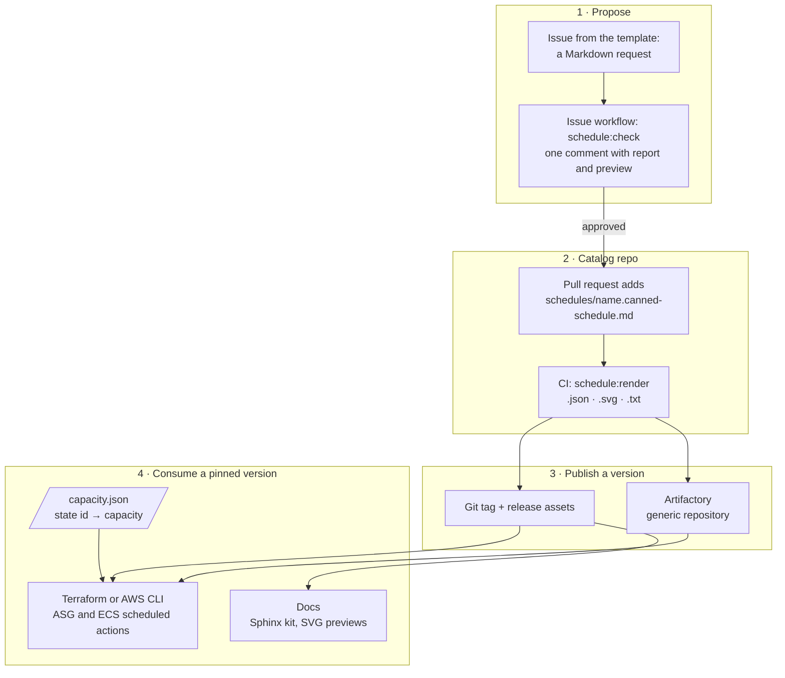

# Canned Schedules

[](https://iilei.github.io/canned-schedules/)
[](https://codecov.io/gh/iilei/canned-schedules)

Weekly schedules that humans and machines agree on.

Teams propose a schedule in a GitHub or GitLab issue, written in plain Markdown. `canned-schedules` checks it, points
at mistakes by line and column, and turns it into canonical JSON: the state in effect at every minute of the week, plus
the moments the state changes, with ready-made cron expressions.

> [!NOTE]
> Work in progress. The CLI, the input syntax, error reports and previews work end to end. So far there are only
> [pre-releases](https://github.com/iilei/canned-schedules/releases); the syntax may still change before 1.0.

## Example

```markdown
# Office Hours

> [!SCHEDULE-META] Weekdays with a late Friday
> - x-owner: `team-xyz`

> [!SCHEDULE-BASE] Minimum

> [!SCHEDULE-STATE] Medium
> - `06:00` to `22:00` MON-FRI
> - `10:00` to `18:00` SAT

> [!SCHEDULE-STATE] Maximum
> - `16:00` to `00:00` FRI
```


Read it as: the base state is `Minimum`. `Medium` applies on weekdays from 06:00 to 22:00 and on Saturdays from 10:00
to 18:00. `Maximum` applies on Fridays from 16:00 until midnight; it comes later, so it wins where it overlaps the
Friday `Medium` range.

Start a request from the issue template: [GitHub](.github/ISSUE_TEMPLATE/canned_schedule_request.md),
[GitLab](.gitlab/issue_templates/canned_schedule_request.md).

## How it fits together

Schedules are proposed as issues, kept in a catalog repo, published as versions, and consumed by pinned version:



1. **Propose:** someone opens an issue from the template. The issue workflow checks the request and keeps one
   comment with the report and, for a valid request, the preview.
2. **Catalog:** once approved, the request becomes `schedules/<name>.canned-schedule.md` in a catalog repo. CI and
   the pre-commit hook check it; `schedule:render` writes the outputs. [`examples/consumer`](examples/consumer) has
   both steps ready to copy.
3. **Publish:** your pipeline's part. The outputs are plain files, so a git tag with release assets, an Artifactory
   generic repository, or both work. Publish the JSON at least; the digest in it tells consumers whether the
   schedule itself changed.
4. **Consume:** infrastructure code pins a catalog version, reads the schedule's JSON and maps its state ids to
   capacities that stay with the infrastructure (the AWS recipes are under [Output](#output)). Docs
   use the SVG previews or the [Sphinx kit](#sphinx).

## Try it in the browser

The **preflight page** runs the same checker, compiled to WebAssembly, entirely in your browser: start from a preset
(from a bare "Medium all week" to the full issue template), edit it in a highlighting editor that marks errors and
warnings on their lines, and see the week as SVG, the issue as GitHub renders it, a Sphinx handbook view with admonitions coloured from the state
styles (downloadable as a [Sphinx kit](#sphinx)), diagnostics that jump to the offending line, the JSON and the ASCII preview
(downloadable as the [text form](#text-form)). Light and dark themes included;
nothing is uploaded. **Copy link** gives a URL with the document and all settings to share; the document travels in
the URL fragment, which browsers never send to the server. The page's SVG, shown and downloaded, always embeds the
canonical request (like `--svg-embed-source`), so a downloaded picture stays traceable to its schedule. It is published from `master` at **<https://iilei.github.io/canned-schedules/>**; locally:

```sh
mise run web:serve      # builds dist/site and serves it on http://127.0.0.1:8080 (--port to change)
```

## Syntax

A schedule is an H1 heading (the name) plus directive blocks: quotes that start with a `[!SCHEDULE-…]` marker.
Everything else is free text for humans, including standard alerts such as `[!NOTE]`.

| Block                      | Required                         | Content                                                                                               |
| -------------------------- | -------------------------------- | ----------------------------------------------------------------------------------------------------- |
| `[!SCHEDULE-META] summary` | no                               | Optional summary after the marker; list items `` x-<name>: `value` `` for your own bookkeeping        |
| `[!SCHEDULE-BASE] state`   | no, unless `--require-base true` | The state wherever no range applies. Without the block: `--base`, else the first configured state     |
| `[!SCHEDULE-STATE] state`  | no                               | A list of ranges in that state. Any number of blocks; a state may appear in several, later ranges win |

`SCHEDULE` is the only namespace, joined to the kind with a hyphen. Markers and state names are case-insensitive. Any
other alert, including a misspelt `[!SCHEDUEL-STATE]`, is free text unless `--error-unless-alert-pattern` restricts
which alerts may appear: with `--error-unless-alert-pattern '(?i)NOTE|TIP|IMPORTANT|WARNING|CAUTION'`, any other alert
is an error. The pattern is Go regular expression syntax, matched against the whole alert type; schedule directives
are always allowed.

**Ranges** are written `` `start` to `end` WEEKDAYS ``:

- Times are `H:MM` or `HH:MM`, e.g. `6:15` or `21:45`.
- The end is exclusive: `06:00` to `22:00` covers 06:00 up to, but not including, 22:00.
- A range that runs until midnight ends at `00:00`. There is no `24:00`.
- A range belongs to its start day and may cross midnight: `22:00` to `02:00` FRI runs into Saturday 02:00.
- Equal start and end means a full 24 hours: `08:00` to `08:00` MON runs until Tuesday 08:00.
- Weekdays are `MON TUE WED THU FRI SAT SUN` in uppercase, with ranges (`MON-FRI`, also across the weekend: `FRI-MON`)
  and lists (`SAT,SUN`). Weekday ranges are **inclusive**: `MON-FRI` includes Friday, unlike the time range, whose end
  is exclusive.
- Each weekday is written at most once per range: `MON,MON` and `WED-WED` are errors (write `WED`). A day that an
  earlier range already covers, as in `MON-WED,TUE`, gets a warning: it's harmless but usually a typo.
- Later ranges win where they overlap earlier ones.
- A no-break space (as pasted from word processors) counts as an ordinary space everywhere spaces are allowed. Other
  invisible characters, such as a zero-width space, are errors and are shown escaped (`\u200b`) in messages.

The states come from the configuration: `Off`, `Minimum`, `Medium` and `Maximum` by default. A state is anything that
holds for a stretch of the week, such as a capacity level, a support team or a maintenance mode. To use your own, see
[Your own states](#your-own-states).

## Usage

Prebuilt binaries for Linux (x86_64, arm64, armv7), macOS (universal) and Windows (amd64, arm64) are attached to
each [GitHub release](https://github.com/iilei/canned-schedules/releases). Every archive comes with a GPG signature
(`.sig`), a SHA-256 sidecar (`.sha256`) and an SPDX SBOM (`.sbom.json`); `checksums.txt` lists them all and is signed
as well.

- **The release key** has the fingerprint `B645 234C 9CB8 175E CA5D  78A5 C844 7A22 52E9 E7B6` (ed25519). Its public
  half is [`release-key.asc`](release-key.asc), attached to every release and published on
  [GitHub](https://github.com/iilei.gpg), keys.openpgp.org and keyserver.ubuntu.com. In a checkout,
  `mise run release:verify <dir>` checks a downloaded release (`gh release download <tag> --dir <dir>`) against that
  key alone, plus the checksums and sidecars.
- **Build provenance:** every file in `checksums.txt` has a GitHub attestation that it was built by this repo's
  release workflow: `gh attestation verify <archive> --repo iilei/canned-schedules` (gh 2.49 or newer; Ubuntu's
  packaged gh may be older).
- **With [mise](https://mise.jdx.dev),** `mise use github:iilei/canned-schedules@<version>` installs a release binary
  and checks it against the SHA-256 digest GitHub records for the download and against its provenance attestation
  (not the GPG signature).

Or build from a checkout (Go 1.25, tools pinned via [mise](https://mise.jdx.dev)):

```sh
mise install
go build ./cmd/canned-schedules
./canned-schedules [flags] request.md
```

The input is always a regular file of at most 256 KiB, given after the flags. On success the canonical JSON goes to
stdout and the exit code is 0. Otherwise each problem goes to stderr as `path:line:col`, with exit code 1 for errors in
the document or in flag values and 2 for an unusable command line or environment (no file, several files, flags after
the file, unreadable input, report not writable):

```text
request.md:9:17: error[invalid-time]: 24:00 is not a valid time: the end of a range is exclusive, so a range that runs until midnight ends at 00:00, e.g. `21:45` to `00:00`
```

`canned-schedules --help` prints the same list.

<!-- generated: flags (mise run docs; from the flag set in internal/cli) -->
**Evaluation**

| Flag                                   | Default     | Meaning                                                                                             |
| -------------------------------------- | ----------- | --------------------------------------------------------------------------------------------------- |
| `--sample-interval <minutes>`          | `1`         | Every time must be a multiple of it; must divide 60 (e.g. `15`, `60`)                               |
| `--require-base true\|false`           | `false`     | `true`: the document must contain a BASE block; can't be combined with `--base`                     |
| `--base <state>`                       | first state | Base state when the document has no BASE block                                                      |
| `--error-unless-alert-pattern <regex>` |             | Every alert other than a schedule directive must match (whole type, Go syntax, `(?i)` for any case) |

**Configuration**

| Flag                        | Default | Meaning                                                                                                                     |
| --------------------------- | ------- | --------------------------------------------------------------------------------------------------------------------------- |
| `--set-config-at <path>`    |         | Config path to replace, e.g. `representation.styles.states[0]` (repeatable)                                                 |
| `--set-config-value <json>` |         | JSON value for the matching `--set-config-at` (repeatable)                                                                  |
| `--ascii-symbols <preset>`  | `ascii` | Symbols in the ASCII preview: `ascii`, `braille` or `styles` (shorthand for `--set-config-at representation.ascii.symbols`) |

**Outputs**

| Flag                              | Default | Meaning                                                                                                                          |
| --------------------------------- | ------- | -------------------------------------------------------------------------------------------------------------------------------- |
| `--output json\|ascii\|text`      | `json`  | What stdout carries: the canonical JSON, the ASCII preview or the text form (the canonical request with the ASCII preview)       |
| `--json-output-file <path>`       |         | Write the canonical JSON (only when the document has no errors)                                                                  |
| `--svg-output-file <path>`        |         | Write an SVG preview (only when the document has no errors)                                                                      |
| `--svg-theme auto\|light\|dark`   | `auto`  | SVG colours: `auto` (follow the viewer), `light` or `dark`                                                                       |
| `--svg-embed-source`              |         | Embed the canonical request in the SVG's metadata, with the schedule digest; needs `--svg-output-file`                           |
| `--ascii-output-file <path>`      |         | Write an ASCII preview (only when the document has no errors)                                                                    |
| `--text-output-file <path>`       |         | Write the text form: the canonical request with the ASCII preview, itself a valid request (only when the document has no errors) |
| `--color auto\|always\|never`     | `auto`  | Colours in the ASCII preview; `auto` means on a terminal only, and not with `NO_COLOR`                                           |
| `--preview-downsample[=N]`        | `15`    | Preview buckets in minutes (must divide 60); `=N` needs the `=`                                                                  |
| `--no-preview-downsample`         |         | Preview at 1-minute resolution (1440 columns per day)                                                                            |
| `--myst-output-file <path>`       |         | Write the schedule as MyST for Sphinx (only when the document has no errors)                                                     |
| `--sphinx-kit-output-file <path>` |         | Write the Sphinx kit zip (only when the document has no errors)                                                                  |

**Error report**

| Flag                              | Default | Meaning                                                                   |
| --------------------------------- | ------- | ------------------------------------------------------------------------- |
| `--error-output-file <path>`      | stderr  | Write the error report to this file (always, even when empty)             |
| `--error-output-format txt\|json` | `txt`   | Error report format: `txt` or `json`                                      |
| `--error-report-template <name>`  |         | Render the error report with the built-in `markdown-gfm` template instead |

**Other**

| Flag        | Default | Meaning                    |
| ----------- | ------- | -------------------------- |
| `--help`    |         | Print this help and exit   |
| `--version` |         | Print the version and exit |
<!-- end generated -->

## Previews

```sh
./canned-schedules --output ascii request.md
```

```text
Office Hours - Weekdays with a late Friday

    00:00                   06:00                   12:00                   18:00
    + : | : | : | : | : | : + : | : | : | : | : | : + : | : | : | : | : | : + : | : | : | : | : | :
MON ::::::::::::::::::::::::================================================================::::::::
FRI ::::::::::::::::::::::::========================================################################
SAT ::::::::::::::::::::::::::::::::::::::::================================::::::::::::::::::::::::

    . Off   : Minimum (base)   = Medium   # Maximum
```

(Rows for TUE–THU and SUN omitted here.) On a terminal each cell gets the dark theme's state colour as its background;
`--color never` turns that off, `--color always` forces it (also into files).

**Symbols.** By default the preview is pure ASCII (`.` `:` `=` `#` by state order), so it lines up in every terminal,
log and email. `--ascii-symbols braille` switches to `⠀` `⣀` `⣤` `⣶` `⣿`, a denser look that is still single-width
everywhere (unlike block characters such as `▒`, which CJK terminals draw double-width). `--ascii-symbols styles`
uses each configured style's own `symbol`. The flag is shorthand for
`--set-config-at representation.ascii.symbols`.

**Downsampling.** Previews show buckets of 15 minutes by default, so a day fits into 96 columns (100 with the day
label). `--preview-downsample=N` picks another bucket size (a divisor of 60), `--no-preview-downsample` shows every
minute. A bucket that contains more than one state shows the one covering most of it; the tool then warns that the
preview is approximate. Downsampling only affects previews: the JSON output stays exact. For exact previews, require
times on the bucket grid with `--sample-interval 15`.

### SVG preview

`--svg-output-file preview.svg` writes a picture of the week like the one above: one row per day, a time ruler, the
transitions with POSIX and AWS cron, and a legend with the base state marked. Hovering a block shows its state, its time
range and the cron expression that starts it. Colours come from the configuration's styles and follow the viewer's
light or dark mode. The preview is only written when the document has no errors, so a failed run never replaces a
good preview with a broken one.

The SVG comes from the built-in [`templates/schedule-svg.tmpl`](templates/schedule-svg.tmpl). The tool computes all
coordinates, colours and labels, so the template is plain markup that also runs with gomplate.

With `--svg-embed-source`, the SVG also carries the request in its `<metadata>`: the canonical form (see below) as a
`cs:source` element with the schedule digest and the generating version as attributes. The picture can then
regenerate everything, and the digest ties it to its JSON. It is opt-in, because `x-*` values such as owners or issue
links then travel with every copy of the picture. Any XML tool reads it back, for example:

```sh
xmllint --xpath 'string(//*[local-name()="source"])' preview.svg > request.md
```

### Text form

`--output text` (or `--text-output-file <path>`) gives the request's **canonical form** with the ASCII preview in a
fenced block after the name:

````markdown
# Office Hours

~~~text
Office Hours - Weekdays with a late Friday

    00:00                   06:00                   12:00                   18:00
    + : | : | : | : | : | : + : | : | : | : | : | : + : | : | : | : | : | : + : | : | : | : | : | :
MON ::::::::::::::::::::::::================================================================::::::::
...
~~~

> [!SCHEDULE-META] Weekdays with a late Friday

> [!SCHEDULE-BASE] Minimum

> [!SCHEDULE-STATE] Medium
> - `06:00` to `22:00` MON-FRI
````

The canonical form keeps only what the syntax defines: the name, META, BASE and the STATE blocks with their ranges, in
source order. Prose, other alerts and links are dropped. Times are written `HH:MM`, weekday expressions without spaces
(`SAT, SUN` becomes `SAT,SUN`) and state names as the configuration spells them; grouping and order stay as written.
The text form is itself a valid request that evaluates to the same output and digest, because the parser reads a
code block as prose.

## Schedules in a repo

Keep each approved schedule as a `*.canned-schedule.md` file, for example `schedules/on-call.canned-schedule.md`. The
suffix lets tools find them without catching unrelated Markdown. [`examples/consumer`](examples/consumer) is a
ready-to-copy setup, tested in this repo's CI:

- **`mise run schedule:render [file...]`** renders every schedule (or the given ones) into three files next to it and
  prints the text form, in colour on a terminal:
  - `.canned-schedule.json`: the canonical output;
  - `.canned-schedule.svg`: the preview, with the request embedded;
  - `.canned-schedule.txt`: the text form.

  It reports every broken file before failing. When a file fails, its outputs are deleted, and so are outputs whose
  source is gone, so nothing stale looks current. Files git tracks are never deleted.
- **The outputs are gitignored** by the example's `.gitignore`. To show a preview on GitHub, commit that SVG instead
  and let CI render and run `git diff --exit-code`.
- **`mise run schedule:check <file> [out-dir]`** checks one request, for example an issue body, and writes
  `report.md`, `report.json`, `comment.md` (the comment to post) and, when valid, the JSON and the text form. The
  example's issue workflow runs it and posts the comment; the task itself never talks to GitHub.
- **`mise run schedule:pre-commit`** checks what is staged, not the working tree. Install it as a git hook with
  `mise generate git-pre-commit --write --task schedule:pre-commit`.
- **`canned-schedules.args`** holds flags for every call, one per line. The example makes alerts strict, so a typo
  such as `[!SCHEDUEL-STATE]` fails instead of being read as prose.

Without mise, the hooks also work with [pre-commit](https://pre-commit.com), which builds the binary from the tag:

```yaml
repos:
  - repo: https://github.com/iilei/canned-schedules
    rev: v0.0.1-pre.5
    hooks:
      - id: canned-schedules
```

## Sphinx

The preflight page's Sphinx view is not a mock-up: the same look is available for real Sphinx docs built with the
[Furo](https://pradyunsg.me/furo/) theme. `--sphinx-kit-output-file kit.zip` (or **Download Sphinx kit** on the page)
writes a zip with:

- a local Sphinx extension (`_ext/canned_schedules`) that adds the stylesheet and fonts and enables MyST's
  `colon_fence`;
- the stylesheet, generated from the same state styles as the SVG and the page. It styles only schedule admonitions,
  through Furo's own admonition variables, and follows Furo's light, dark and auto modes;
- Ubuntu and Ubuntu Mono, used only inside schedule admonitions;
- the request as MyST, and a README with the two `conf.py` lines:

  ```python
  sys.path.append(os.path.abspath("_ext"))
  extensions += ["canned_schedules"]
  ```

`--myst-output-file schedule.md` writes just the MyST for a request: the name, the summary, and the META, BASE and STATE
blocks as `:::{admonition}` blocks with the classes the stylesheet expects, items written as in the request. The issue's
free text stays out. Colours follow `--set-config-*`; regenerate the kit after changing the state styles. On the page,
**Download MyST** gives the same file for the document in the editor.

### From request to docs page

Treat the MyST as build output: people edit and review the GitHub-flavoured request, and the docs build regenerates
the MyST from it. Nobody edits the MyST by hand. Validation then stays in one place, because the tool writes no MyST
for an invalid request and exits with 1.

In CI, run a step like this before `sphinx-build`:

```sh
for src in schedules/*.canned-schedule.md; do
  name=$(basename "$src" .canned-schedule.md)
  canned-schedules --myst-output-file "docs/schedules/$name.md" "$src" >/dev/null
done
```

- **Invalid schedules fail the build.** The error report goes to stderr; use `--error-output-file` to keep it.
- **Generated files:** either add `docs/schedules/` to `.gitignore`, or commit the files and let CI regenerate them
  and run `git diff --exit-code docs/schedules`, so they can't drift from the requests.
- **Each generated file is a page:** list them in a toctree, for example with `:glob:` and `schedules/*`. Put prose
  about a schedule on a hand-written page that links to it.

## Rendering elsewhere

GitHub and GitLab show schedule directives as plain quotes with the marker as text. Tools that follow the Obsidian
callout convention (a custom type plus a title on the marker line) render them as callouts. We recommend
[rehype-callouts](https://github.com/lin-stephanie/rehype-callouts) for remark/rehype sites such as Astro. It only
renders types it knows, so register the three kinds:

```js
import rehypeCallouts from "rehype-callouts";

rehype().use(rehypeCallouts, {
  callouts: {
    "schedule-meta": { title: "Schedule" },
    "schedule-base": { title: "Base state" },
    "schedule-state": { title: "State" },
  },
});
```

The text after the marker becomes the callout's title (the state id or the summary), and each block gets
`data-callout="schedule-state"` (lowercase) for styling with one of its themes:

```css
[data-callout="schedule-state"] {
  --rc-color-light: #2f855a;
  --rc-color-dark: #68d391;
}
```

Colours per state, display names and weekday-aware layout need the tool itself: use the [Sphinx kit](#sphinx) or the
SVG preview for those.

## Error reports

`canned-schedules` never posts anything to GitHub or GitLab. It writes an error report that your CI job or bot can
use, in one of three shapes:

- `txt` (default): one `path:line:col: severity[code]: message` line per problem, as editors and CI annotators expect.
- `json`: `{"schema-version", "file", "summary": {"errors", "warnings"}, "diagnostics": [...]}`; each diagnostic has
  `severity`, `code`, `file`, `line`, `column`, a ready-made `location` (`path:line:col`), `message` (plain prose),
  an optional `example` (the exact Markdown to type, backticks included) and an `excerpt` (the source line with a
  caret under the column). Schema: [`schema/report.schema.json`](schema/report.schema.json).
- `--error-report-template markdown-gfm`: the JSON rendered with the built-in
  [`templates/markdown-gfm.tmpl`](templates/markdown-gfm.tmpl), ready to paste into an issue comment.

```sh
./canned-schedules --error-report-template markdown-gfm --error-output-file report.md request.md
```

There is exactly one built-in template. For your own layout, write the JSON report and render it yourself, for
example with gomplate; the built-in template is a working starting point:

```sh
./canned-schedules --error-output-format json --error-output-file report.json request.md
gomplate -c .=report.json -f templates/markdown-gfm.tmpl
```

Paths are reported as you pass them; absolute paths inside your home directory are shortened to `~/…`, so reports
don't spell out your user name. In CI, pass paths relative to the repository root so annotations match the files (on
many runners the workspace lies inside the home directory).

Safety: the report file is written atomically (temporary file plus rename), so a planted symlink is replaced instead
of written through. Control characters and bidirectional formatting characters in paths and messages are escaped,
so a crafted file name can't forge log lines. In the Markdown, everything that comes from the document or the file
name sits inside a fenced block, where links, HTML, `@mentions` and `#references` don't render.

### Diagnostic codes

Every diagnostic carries one of these codes; the golden fixtures pin them, so they are part of the contract.

<!-- generated: codes (mise run docs; from diag.Codes in internal/diag) -->
| Code                      | Severity | Meaning                                                                                                                                 |
| ------------------------- | -------- | --------------------------------------------------------------------------------------------------------------------------------------- |
| `missing-name`            | error    | The document has no H1 heading; the H1 names the schedule.                                                                              |
| `duplicate-name`          | error    | More than one H1 heading.                                                                                                               |
| `invalid-name`            | error    | The name breaks the text rule: 1-80 ASCII letters, digits, spaces or hyphens, starting with a letter and ending with a letter or digit. |
| `invalid-summary`         | error    | The summary after the META marker breaks the same text rule as the name.                                                                |
| `invalid-marker`          | error    | A directive separates namespace and kind with `:` (`[!SCHEDULE:STATE]`); the separator is `-`.                                          |
| `missing-kind`            | error    | A marker has the namespace but no kind (`[!SCHEDULE]`, `[!SCHEDULE-]`).                                                                 |
| `unknown-kind`            | error    | A kind other than META, BASE or STATE.                                                                                                  |
| `missing-title`           | error    | A BASE or STATE marker without a state name after it.                                                                                   |
| `duplicate-block`         | error    | A second META or BASE block.                                                                                                            |
| `empty-state`             | error    | A STATE block without ranges.                                                                                                           |
| `misplaced-directive`     | error    | A directive that isn't a top-level quote starting with its marker, e.g. nested in a list or wrapped in bold.                            |
| `unexpected-content`      | error    | Content in a BASE block, which takes only a state name on the marker line.                                                              |
| `disallowed-alert`        | error    | An alert that doesn't match `--error-unless-alert-pattern`.                                                                             |
| `invalid-range`           | error    | A STATE item that isn't `` `start` to `end` WEEKDAYS ``, or content other than a list in a STATE block.                                 |
| `invalid-time`            | error    | A time that isn't `H:MM` or `HH:MM` from `00:00` to `23:59` (`24:00` is rejected).                                                      |
| `sample-interval`         | error    | A time that isn't a multiple of `--sample-interval`.                                                                                    |
| `invalid-weekday`         | error    | A weekday expression with an unknown or lowercase name, or a broken range or list.                                                      |
| `duplicate-weekday`       | error    | The same weekday written twice in one item (`MON,MON`, `WED-WED`).                                                                      |
| `repeated-weekday`        | warning  | A day that an earlier part of the same item already covers (`MON-WED,TUE`); the range still applies.                                    |
| `meta-schema`             | error    | META content that isn't a list of ``key: `value` `` items, or a key or value the META schema rejects.                                   |
| `unknown-state`           | error    | A state name the configuration doesn't define, in BASE, STATE or `--base`.                                                              |
| `missing-base`            | error    | `--require-base true`, and the document has no BASE block.                                                                              |
| `config-schema`           | error    | The configuration, after overrides, fails its JSON Schema.                                                                              |
| `invalid-override`        | error    | A `--set-config-at` path that doesn't exist, or a `--set-config-value` that isn't JSON.                                                 |
| `config-duplicate-state`  | error    | Two state ids in the configuration that are equal ignoring case.                                                                        |
| `config-duplicate-symbol` | warning  | Two styles share a symbol, so the `styles` ASCII preset tells those states apart only by colour.                                        |
| `style-reuse`             | warning  | Fewer styles than states: styles repeat round robin, so states become hard to tell apart.                                               |
| `invalid-flag`            | error    | An unknown flag or an invalid flag value.                                                                                               |
| `invalid-args`            | error    | No input file, several files, or flags after the file (exit code 2).                                                                    |
| `input-file`              | error    | The input can't be read: missing, not a regular file, or larger than 256 KiB (exit code 2).                                             |
| `preview-approximate`     | warning  | Preview buckets mix states, so the preview rounds; reported only when a preview is requested.                                           |
| `output-schema`           | error    | The tool's own output failed its schema: a bug in canned-schedules, please report it.                                                   |
<!-- end generated -->

## Output

```json
{
  "schema-version": "2026-10-25",
  "name": "Office Hours",
  "summary": "Weekdays with a late Friday",
  "base": "Minimum",
  "annotations": {"x-owner": "team-xyz"},
  "digests": {"schedule": "sha256:…"},
  "week": {
    "MON": [
      {"start": "00:00", "end": "06:00", "state": "Minimum"},
      {"start": "06:00", "end": "22:00", "state": "Medium"},
      {"start": "22:00", "end": "00:00", "state": "Minimum"}
    ],
    "TUE": ["…"]
  },
  "transitions": [
    {
      "time": "06:00",
      "days": ["MON", "TUE", "WED", "THU", "FRI"],
      "state": "Medium",
      "cron": {"posix": "0 6 * * 1-5", "aws": "0 6 ? * MON-FRI *"}
    }
  ],
  "warnings": []
}
```

- `week` covers every day from `00:00` to `00:00` in half-open runs; an `end` of `00:00` means the end of the day.
- `transitions` lists every moment the state changes, grouped by time and state, so time and state together identify
  a transition within a schedule (there is no id field; see the AWS recipes for naming). `cron.posix` is five-field Unix cron
  (as EC2 Auto Scaling scheduled actions use), `cron.aws` the six-field format of EventBridge and Application Auto
  Scaling. Neither carries a time
  zone: set it where you schedule them.
- `warnings` lists warnings (e.g. `style-reuse`, `preview-approximate`) with code, message and, when positioned,
  line, column and excerpt. No file names: the output depends only on the document and the flags.
- `digests.schedule` changes only when the base or the week changes, never for the name, summary, annotations or
  prose. To trace a schedule back to its source, carry a git SHA or an issue link in an `x-*` META key.
- The schema is [`schema/output.schema.json`](schema/output.schema.json); details in
  [`testdata/golden/README.md`](testdata/golden/README.md).

Provider settings such as capacity numbers are out of scope: attach them to the state ids downstream.

### AWS Auto Scaling scheduled actions

> [!WARNING]
> Unverified against AWS. The Terraform below passes `terraform validate` with the AWS provider, and the CLI script
> was run against a stubbed `aws`, but neither has created real scheduled actions yet.

Each transition becomes one scheduled action: `cron.posix` is its recurrence, and the capacity comes from a map you
keep next to your infrastructure, keyed by state id:

```json
{
  "Off":     {"min": 0, "desired": 0, "max": 0},
  "Minimum": {"min": 1, "desired": 1, "max": 2},
  "Medium":  {"min": 2, "desired": 4, "max": 6},
  "Maximum": {"min": 4, "desired": 8, "max": 12}
}
```

With Terraform, `for_each` over the transitions, keyed by time, days and state (`0600-MON_TUE_WED_THU_FRI-Medium`), so
the key says what the action does, and Terraform removes the actions of transitions that disappear:

```hcl
locals {
  schedule = jsondecode(file("${path.module}/office-hours.canned-schedule.json"))
  capacity = jsondecode(file("${path.module}/capacity.json"))
  transitions = { for t in local.schedule.transitions : "${replace(t.time, ":", "")}-${join("_", t.days)}-${t.state}" => t }
}

resource "aws_autoscaling_schedule" "office_hours" {
  for_each = local.transitions

  autoscaling_group_name = aws_autoscaling_group.app.name
  scheduled_action_name  = "office-hours-${each.key}"
  recurrence             = each.value.cron.posix
  time_zone              = "Etc/UTC"
  min_size               = local.capacity[each.value.state].min
  desired_capacity       = local.capacity[each.value.state].desired
  max_size               = local.capacity[each.value.state].max
}
```

With the AWS CLI (bash and jq), replace the schedule's actions in one go:

```bash
asg=my-asg
prefix=office-hours
schedule=office-hours.canned-schedule.json

# One action per transition: its cron as the recurrence, the state's capacity from capacity.json. Computed before
# anything changes, so a state without a capacity stops the run while the group still has its old schedule.
actions=$(jq -r --slurpfile cap capacity.json --arg prefix "$prefix" '
  .transitions[]
  | ($cap[0][.state] // error("capacity.json has no entry for state \(.state)")) as $c
  | [$prefix + "-" + (.time | sub(":"; "")) + "-" + (.days | join("_")) + "-" + .state, .cron.posix, $c.min,
     $c.desired, $c.max]
  | @tsv' "$schedule")

# Remove this schedule's earlier actions, so a transition that was dropped from the request stops firing.
aws autoscaling describe-scheduled-actions --auto-scaling-group-name "$asg" --output json \
  --query "ScheduledUpdateGroupActions[?starts_with(ScheduledActionName, '$prefix-')].ScheduledActionName" |
  jq -r '.[]' |
  while read -r name; do
    aws autoscaling delete-scheduled-action --auto-scaling-group-name "$asg" --scheduled-action-name "$name"
  done

while IFS=$'\t' read -r name cron min desired max; do
  [ -n "$name" ] || continue
  aws autoscaling put-scheduled-update-group-action --auto-scaling-group-name "$asg" \
    --scheduled-action-name "$name" --recurrence "$cron" --time-zone Etc/UTC \
    --min-size "$min" --desired-capacity "$desired" --max-size "$max"
done <<< "$actions"
```

- **The time zone is yours to choose.** The tool writes wall-clock times without a zone. `Etc/UTC` matches the
  recommended convention; with a zone such as `Europe/Berlin`, Auto Scaling follows its daylight saving changes.
- **Capacity until the next transition:** scheduled actions only fire at their times. After the first deployment the
  group keeps its current capacity until the next transition, so set it to the state in effect now (from `week`).
  With Terraform, also add `lifecycle { ignore_changes = [min_size, max_size, desired_capacity] }` to the group, or
  every apply resets what the actions set.
- **No transitions** (one state all week): there are no actions to create. Give the group the base state's capacity
  directly.
- **Limits:** Auto Scaling allows 125 scheduled actions per group, which is far more than a weekly schedule needs.
- **Names are yours to define.** The output has no id field on purpose: what makes two actions "the same" depends on
  your setup, and a field whose meaning could change would be the riskiest part of the contract. The key above,
  `<HHMM>-<days>-<state>`, carries every fact of the transition, so it is unique within one schedule and readable in
  the console. Changing a transition's time, days or state gives it a new name, so the action is replaced. To update
  actions in place when only their days change, leave the days out (`<HHMM>-<state>` is still unique within one
  schedule, since transitions are grouped by time and state).
- **Several schedules in one group:** keys are unique within one schedule only. Two schedules with a `Minimum` on
  Friday at `22:00` both give `2200-FRI-Minimum`. Action names only need to be unique per group, so one schedule per
  group is fine; when several schedules share a group or one `for_each` map (where `merge()` would silently keep only
  one of them), put the schedule's name into the key, e.g. `maintenance-2200-FRI-Minimum`.

#### ECS services and other Application Auto Scaling targets

Application Auto Scaling (ECS services, DynamoDB capacity, Aurora replicas, Lambda provisioned concurrency, …) takes
the six-field format, so use `cron.aws` there, wrapped as `cron(...)`. Its actions set min and max only; there is no
desired count. The target has to be registered before its scheduled actions, here with the base state's capacity:

```hcl
resource "aws_appautoscaling_target" "app" {
  service_namespace  = "ecs"
  resource_id        = "service/${aws_ecs_cluster.main.name}/${aws_ecs_service.app.name}"
  scalable_dimension = "ecs:service:DesiredCount"
  min_capacity       = local.capacity[local.schedule.base].min
  max_capacity       = local.capacity[local.schedule.base].max

  # The scheduled actions move min and max; without this, every apply would reset them to the base state's values.
  lifecycle {
    ignore_changes = [min_capacity, max_capacity]
  }
}

resource "aws_appautoscaling_scheduled_action" "office_hours" {
  for_each = local.transitions

  name               = "office-hours-${each.key}"
  service_namespace  = aws_appautoscaling_target.app.service_namespace
  resource_id        = aws_appautoscaling_target.app.resource_id
  scalable_dimension = aws_appautoscaling_target.app.scalable_dimension
  schedule           = "cron(${each.value.cron.aws})"
  timezone           = "Etc/UTC"

  scalable_target_action {
    min_capacity = local.capacity[each.value.state].min
    max_capacity = local.capacity[each.value.state].max
  }
}
```

`local.transitions` and `local.capacity` are the ones from the EC2 example. With the AWS CLI, the same values go to
`aws application-autoscaling put-scheduled-action` (`--schedule "cron(...)" --timezone Etc/UTC
--scalable-target-action MinCapacity=…,MaxCapacity=…`).

## Configuration

The built-in configuration ([`schema/config.json`](schema/config.json), validated by
[`schema/config.schema.json`](schema/config.schema.json)) defines the ordered state list and how states look: page
colours per light/dark theme, one style (symbol and colours) per state assigned round robin, and the symbol preset of
the ASCII preview (`representation.ascii.symbols`). Override any part of
it per run:

```sh
./canned-schedules \
  --set-config-at 'states[0].display-name' --set-config-value '"Switched off"' \
  request.md
```

An override replaces the value at its path; the path and the array index must exist.

### Your own states

Replace the whole `states` list to schedule something other than capacity. For example, follow-the-sun on-call:

```sh
./canned-schedules \
  --set-config-at states \
  --set-config-value '[{"id": "Nobody",  "display-name": "Nobody"},
                       {"id": "Team-EU", "display-name": "Team EU"},
                       {"id": "Team-US", "display-name": "Team US"}]' \
  oncall.md
```

```markdown
# On-Call

> [!SCHEDULE-BASE] Nobody

> [!SCHEDULE-STATE] Team-EU
> - `06:00` to `14:00` MON-FRI

> [!SCHEDULE-STATE] Team-US
> - `14:00` to `22:00` MON-FRI
```

- Only the listed ids are valid in BASE and STATE blocks. The first one is the base when the document has none.
- Colours and symbols are assigned round robin from `representation.styles.states`, so override those only for
  specific colours.
- To share a configuration, keep it in a file and pass `--set-config-value "$(cat states.json)"`.
- The week repeats unchanged. Rotations that alternate between weeks ("Alice this week, Bob next week") can't be
  expressed, and overlapping roles such as primary and secondary on-call need one document each.

## Stability

Until 1.0, any release may break things; a breaking change always comes with a new `schema-version`.

- **`schema-version` is a date:** the date of the last breaking change to any of the contracts, which are the document
  syntax with its META, the configuration, the JSON output and the error report. This version reads and writes
  `2026-10-25`. Documents don't have to declare it; one that declares another version is rejected with a hint.
- **The schemas** of each version are published at
  `https://iilei.github.io/canned-schedules/schema/<date>/` (`output`, `report`, `config` and `meta`, each
  `.schema.json`) and attached to every release, listed in its signed `checksums.txt`. The tool never fetches them;
  they're built in.
- **Not breaking (the date stays):** new fields in the output or the report, new warning codes, new flags, accepting
  input that used to be rejected, clearer descriptions. The output and report schemas allow additional properties,
  so newer output still validates against the schema of its date. Read the output tolerantly: ignore fields and
  warning codes you don't know.
- **Breaking (a new date):** removing or renaming a field, changing its type, making a field required, tightening a
  pattern, rejecting input that used to be accepted, changing how the digest is computed, and changing what a field
  means, which no schema can detect. A change of meaning comes as a new field instead; the old one goes at the next
  breaking change.
- **Not part of the contract:** diagnostic messages (their codes are), the layout of the previews, and the JSON's key
  order (stable, but parse the JSON rather than matching its text).

## Development

```sh
mise run check      # format check, vet, lint, tests (race detector), build
mise run test:wasm  # the same tests compiled to WebAssembly, run under Node
mise run web:serve  # build and serve the preflight page
mise run fmt        # apply formatting
```

The spec lives in [`testdata/golden`](testdata/golden): one directory per case with the input, optional CLI
arguments, and the expected output or diagnostics. `python3 testdata/golden/gen.py` regenerates them from an
independent reference implementation; review the diff like any other change. Never derive fixtures from the Go code.

The page's editor is [CodeMirror 6](https://codemirror.net/), bundled from [`editor/`](editor) by `web:build` with the
versions locked in `editor/package-lock.json` (`npm ci`, install scripts off). The licences of the bundled packages
are published next to it as `editor-licenses.txt`. Without `editor.js` the page falls back to a plain textarea.

## License

canned-schedules is licensed under the [Functional Source License, Version 1.1, ALv2 Future License](LICENSE.md)
(FSL-1.1-ALv2). You may use it for any purpose, internal company use included, except offering a competing commercial
product or service. Each release becomes available under the Apache License 2.0 two years after it is published. The
licence grants no rights to the name or the logo.

Bundled third-party components keep their own licences: the Go modules compiled into the binary (listed in
`THIRD_PARTY_LICENSES.md` in the release archives), the fonts in [`assets/fonts`](assets/fonts) (Ubuntu Font
Licence, SIL Open Font License) and the page's editor bundle (`editor-licenses.txt`).
