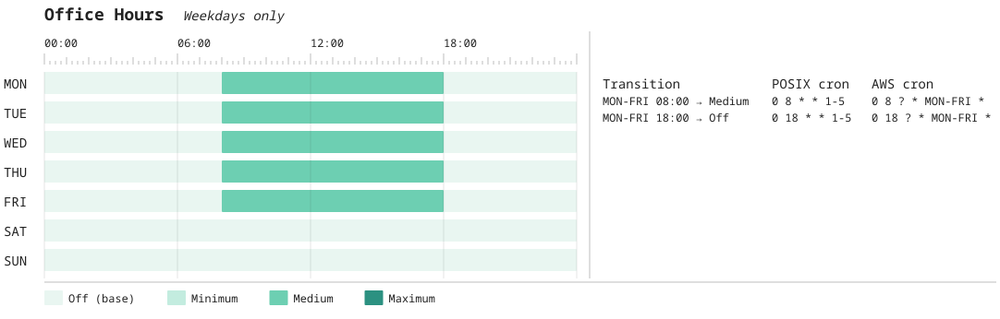

# Canned Schedules

[](https://iilei.github.io/canned-schedules/)
[](https://iilei.github.io/canned-schedules/playground/)
[](https://codecov.io/gh/iilei/canned-schedules)

Weekly schedules that humans and machines agree on.

Teams propose a schedule in a GitHub or GitLab issue, written in plain Markdown. `canned-schedules` checks it, points
at mistakes by line and column, and turns it into canonical JSON: the state in effect at every minute of the week, plus
the moments the state changes, with ready-made cron expressions.

> [!NOTE]
> Version 0.x: the CLI, the input syntax, error reports and previews work end to end, and
> [releases](https://github.com/iilei/canned-schedules/releases) are signed. The contract may still change before 1.0;
> see [Stability](https://iilei.github.io/canned-schedules/stability.html) for how changes are announced.

```markdown
# Office Hours

> [!SCHEDULE-META] Weekdays only
> - x-owner: `team-xyz`

> [!SCHEDULE-BASE] Off

> [!SCHEDULE-STATE] Medium
> - `08:00` to `18:00` MON-FRI
```



Read it as: the base state is `Off`, and `Medium` applies on weekdays from 08:00 to 18:00.

## Get started

- **In the browser:** the [playground](https://iilei.github.io/canned-schedules/playground/) checks a schedule as you type and shows its week; nothing
  leaves the browser.
- **On the command line:** install a [signed release](https://github.com/iilei/canned-schedules/releases), for example
  with [mise](https://mise.jdx.dev) (`mise use github:iilei/canned-schedules@<version>`), then run
  `canned-schedules schedule.md`. [Usage](https://iilei.github.io/canned-schedules/usage.html) covers verification, flags and exit codes.
- **In a repository:** [host your own schedule catalog](https://iilei.github.io/canned-schedules/self-hosted-catalog.html) with issue previews, a
  playground, merge request reviews and publishing, from
  [canned-schedules-companion](https://github.com/iilei/canned-schedules-companion).

## Documentation

The documentation lives at **[iilei.github.io/canned-schedules](https://iilei.github.io/canned-schedules/)**, built from [`docs/`](docs):

- **Write and check:** [the syntax](https://iilei.github.io/canned-schedules/syntax.html), [the CLI](https://iilei.github.io/canned-schedules/usage.html),
  [previews](https://iilei.github.io/canned-schedules/previews.html), [error reports](https://iilei.github.io/canned-schedules/error-reports.html), [examples](https://iilei.github.io/canned-schedules/examples.html).
- **Use the output:** [the JSON](https://iilei.github.io/canned-schedules/output.html), [AWS Auto Scaling](https://iilei.github.io/canned-schedules/aws.html),
  [configuration](https://iilei.github.io/canned-schedules/configuration.html), [schedules in a repo](https://iilei.github.io/canned-schedules/catalog.html), [Sphinx](https://iilei.github.io/canned-schedules/sphinx.html),
  [the Go library](https://iilei.github.io/canned-schedules/library.html).
- **Run a catalog:** [the self-hosted catalog](https://iilei.github.io/canned-schedules/self-hosted-catalog.html),
  [links into your playground](https://iilei.github.io/canned-schedules/playground-links.html), with stories of a
  [shift swap](https://iilei.github.io/canned-schedules/stories/shift-swap/README.html) and a
  [classroom's capacity](https://iilei.github.io/canned-schedules/stories/classroom-capacity/README.html).
- **Project:** [stability](https://iilei.github.io/canned-schedules/stability.html), [development](https://iilei.github.io/canned-schedules/development.html).

## License

canned-schedules is licensed under the [Functional Source License, Version 1.1, ALv2 Future License](LICENSE.md)
(FSL-1.1-ALv2). You may use it for any purpose, internal company use included, except offering a competing commercial
product or service. Each release becomes available under the Apache License 2.0 two years after it is published. The
licence grants no rights to the name or the logo.

Bundled third-party components keep their own licences: the Go modules compiled into the binary (listed in
`THIRD_PARTY_LICENSES.md` in the release archives), the fonts in [`assets/fonts`](assets/fonts) (Ubuntu Font
Licence, SIL Open Font License) and the page's editor bundle (`editor-licenses.txt`).
