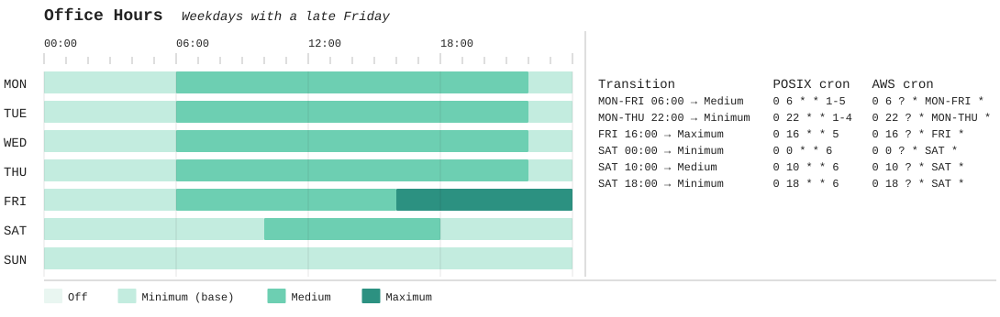

# Canned Schedules

Weekly capacity schedules from human-friendly Markdown: validate, preview and export.

Teams propose a schedule in a GitHub or GitLab issue, written in plain Markdown. `canned-schedules` checks it, points
at mistakes by line and column, and turns it into canonical JSON: the tier in effect at every minute of the week, plus
the moments the tier changes, with ready-made cron expressions.

> [!NOTE]
> Work in progress. The CLI, the input syntax, error reports and SVG previews work end to end; releases are still to
> come. Older files (CUE, jq, shell) are leftovers from earlier designs.

## Example

```markdown
# Office Hours

> [!SCHEDULE:META] Weekdays with a late Friday
> - x-custom-owner: `team-xyz`

> [!SCHEDULE:BASE] Minimum

> [!SCHEDULE:TIER] Medium
> - `06:00` to `22:00` MON-FRI
> - `10:00` to `18:00` SAT

> [!SCHEDULE:TIER] Maximum
> - `16:00` to `00:00` FRI
```



Read it as: the base tier is `Minimum`. `Medium` applies on weekdays from 06:00 to 22:00 and on Saturdays from 10:00
to 18:00. `Maximum` applies on Fridays from 16:00 until midnight; it comes later, so it wins where it overlaps the
Friday `Medium` range.

Start a request from the issue template: [GitHub](.github/ISSUE_TEMPLATE/canned_schedule_request.md),
[GitLab](.gitlab/issue_templates/canned_schedule_request.md).

## Syntax

A schedule is an H1 heading (the name) plus directive blocks: quotes that start with a `[!SCHEDULE:…]` marker.
Everything else is free text for humans, including standard alerts such as `[!NOTE]`.

| Block                   | Required     | Content                                                                                            |
| ----------------------- | ------------ | -------------------------------------------------------------------------------------------------- |
| `[!SCHEDULE:META] hint` | no           | Optional hint after the marker; list items `` x-custom-<name>: `value` `` for your own bookkeeping |
| `[!SCHEDULE:BASE] tier` | no           | The tier wherever no range applies                                                                 |
| `[!SCHEDULE:TIER] tier` | one per tier | A list of ranges                                                                                   |

`CANNED-SCHEDULE`, `TO-SCHEDULE`, `CAN-SCHED` and `CONFIG-SCHED` work as aliases for `SCHEDULE`. Markers and tier
names are case-insensitive.

**Ranges** are written `` `start` to `end` WEEKDAYS ``:

- Times are `H:MM` or `HH:MM`, e.g. `6:15` or `21:45`.
- The end is exclusive: `06:00` to `22:00` covers 06:00 up to, but not including, 22:00.
- A range that runs until midnight ends at `00:00`. There is no `24:00`.
- A range belongs to its start day and may cross midnight: `22:00` to `02:00` FRI runs into Saturday 02:00.
- Equal start and end means a full 24 hours: `08:00` to `08:00` MON runs until Tuesday 08:00.
- Weekdays are `MON TUE WED THU FRI SAT SUN` in uppercase, with ranges (`MON-FRI`, also across the weekend: `FRI-MON`)
  and lists (`SAT,SUN`).
- Later ranges win where they overlap earlier ones.

The tiers come from the configuration: `Off`, `Minimum`, `Medium` and `Maximum` by default.

## Usage

Build from a checkout (Go 1.25, tools pinned via [mise](https://mise.jdx.dev)):

```sh
mise install
go build ./cmd/canned-schedules
./canned-schedules [flags] request.md
```

The input is always a regular file of at most 256 KiB, given after the flags. On success the canonical JSON goes to
stdout and the exit code is 0. Otherwise each problem goes to stderr as `path:line:col`, with exit code 1 for errors in
the document or in flag values and 2 for an unusable command line or environment (no file, several files, flags after
the file, unreadable input, report not writable):

```text
request.md:9:17: error[invalid-time]: 24:00 is not a valid time: the end of a range is exclusive, so a range that runs until midnight ends at 00:00, e.g. `21:45` to `00:00`
```

| Flag                          | Default    | Meaning                                                                         |
| ----------------------------- | ---------- | ------------------------------------------------------------------------------- |
| `--sample-interval <minutes>` | `1`        | Every time must be a multiple of it; must divide 60 (e.g. `15`, `60`)           |
| `--require-base true\|false`  | `false`    | `true`: the document must contain a BASE block; can't be combined with `--base` |
| `--base <tier>`               | first tier | Base tier when the document has no BASE block                                   |
| `--set-config-at <path>`      |            | Config path to replace, e.g. `representation.styles.tiers[0]` (repeatable)      |
| `--set-config-value <json>`   |            | JSON value for the matching `--set-config-at` (repeatable)                      |
| `--svg-output-file <path>`    |            | Write an SVG preview (only when the document has no errors)                     |
| `--error-output-file <path>`  | stderr     | Write the error report to this file (always, even when empty)                   |
| `--error-output-format`       | `txt`      | Error report format: `txt` or `json`                                            |
| `--error-report-template`     |            | Render the error report with the built-in `markdown-gfm` template instead       |
| `--version`                   |            | Print the version                                                               |

## SVG preview

`--svg-output-file preview.svg` writes a picture of the week like the one above: one row per day, a time ruler, the
transitions with POSIX and AWS cron, and a legend with the base tier marked. Hovering a block shows its tier, its time
range and the cron expression that starts it. Colours come from the configuration's styles and follow the viewer's
light or dark mode. The preview is only written when the document has no errors, so a failed run never replaces a
good preview with a broken one.

The SVG comes from the built-in [`templates/schedule-svg.tmpl`](templates/schedule-svg.tmpl). The tool computes all
coordinates, colours and labels, so the template is plain markup that also runs with gomplate.

## Error reports

`canned-schedules` never posts anything to GitHub or GitLab. It writes an error report that your CI job or bot can
use, in one of three shapes:

- `txt` (default): one `path:line:col: severity[code]: message` line per problem, as editors and CI annotators expect.
- `json`: `{"schema-version", "file", "summary": {"errors", "warnings"}, "diagnostics": [...]}`; each diagnostic has
  `severity`, `code`, `file`, `line`, `column`, a ready-made `location` (`path:line:col`), `message`, and an `excerpt`
  (the source line with a caret under the column). Schema: [`schema/report.schema.json`](schema/report.schema.json).
- `--error-report-template markdown-gfm`: the JSON rendered with the built-in
  [`templates/markdown-gfm.tmpl`](templates/markdown-gfm.tmpl), ready to paste into an issue comment.

```sh
./canned-schedules --error-report-template markdown-gfm --error-output-file report.md request.md
```

There is exactly one built-in template. For your own layout, write the JSON report and render it yourself, for
example with gomplate; the built-in template is a working starting point:

```sh
./canned-schedules --error-output-format json --error-output-file report.json request.md
gomplate -c .=report.json -f templates/markdown-gfm.tmpl
```

Paths are reported as you pass them; absolute paths inside your home directory are shortened to `~/…`, so reports
don't spell out your user name. In CI, pass paths relative to the repository root so annotations match the files (on
many runners the workspace lies inside the home directory).

Safety: the report file is written atomically (temporary file plus rename), so a planted symlink is replaced instead
of written through. Control characters and bidirectional formatting characters in paths and messages are escaped,
so a crafted file name can't forge log lines. In the Markdown, everything that comes from the document or the file
name sits inside a fenced block, where links, HTML, `@mentions` and `#references` don't render.

## Output

```json
{
  "schema-version": "1",
  "name": "Office Hours",
  "hint": "Weekdays with a late Friday",
  "base": "Minimum",
  "annotations": {"x-custom-owner": "team-xyz"},
  "digests": {"request": "sha256:…", "effective": "sha256:…"},
  "week": {
    "MON": [
      {"start": "00:00", "end": "06:00", "tier": "Minimum"},
      {"start": "06:00", "end": "22:00", "tier": "Medium"},
      {"start": "22:00", "end": "00:00", "tier": "Minimum"}
    ],
    "TUE": ["…"]
  },
  "transitions": [
    {
      "time": "06:00",
      "days": ["MON", "TUE", "WED", "THU", "FRI"],
      "tier": "Medium",
      "cron": {"posix": "0 6 * * 1-5", "aws": "0 6 ? * MON-FRI *"}
    }
  ]
}
```

- `week` covers every day from `00:00` to `00:00` in half-open runs; an `end` of `00:00` means the end of the day.
- `transitions` lists every moment the tier changes, grouped by time and tier. `cron.posix` is five-field Unix cron
  (as EC2 Auto Scaling scheduled actions use), `cron.aws` the six-field EventBridge format. Neither carries a time
  zone: set it where you schedule them.
- `digests.request` identifies the exact input; `digests.effective` changes only when the base or the week changes.
- The schema is [`schema/output.schema.json`](schema/output.schema.json); details in
  [`testdata/golden/README.md`](testdata/golden/README.md).

Provider settings such as capacity numbers are out of scope: attach them to the tier ids downstream.

## Configuration

The built-in configuration ([`schema/config.json`](schema/config.json), validated by
[`schema/config.schema.json`](schema/config.schema.json)) defines the ordered tier list and how tiers look: page
colours per light/dark theme and one style (symbol and colours) per tier, assigned round robin. Override any part of
it per run:

```sh
./canned-schedules \
  --set-config-at 'tiers[0].display-name' --set-config-value '"Switched off"' \
  request.md
```

An override replaces the value at its path; the path and the array index must exist.

## Development

```sh
mise run check      # format check, vet, lint, tests (race detector), build
mise run fmt        # apply formatting
```

The spec lives in [`testdata/golden`](testdata/golden): one directory per case with the input, optional CLI
arguments, and the expected output or diagnostics. `python3 testdata/golden/gen.py` regenerates them from an
independent reference implementation; review the diff like any other change. Never derive fixtures from the Go code.
