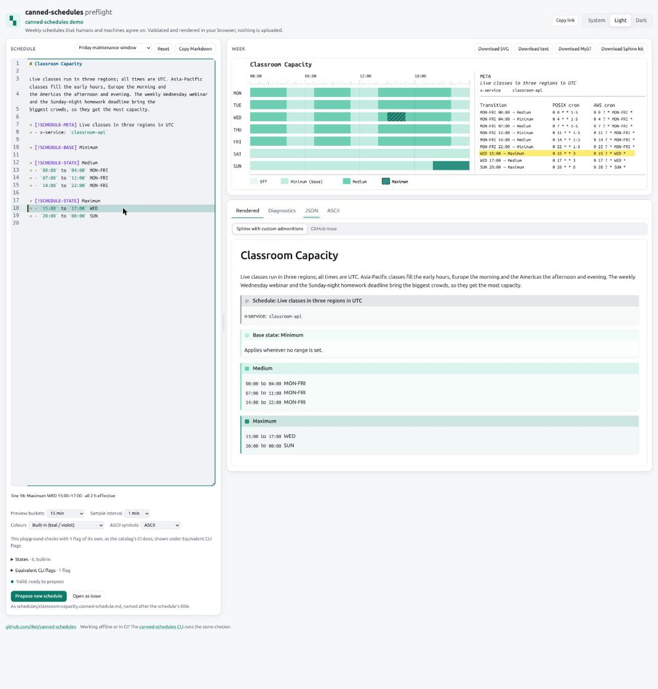
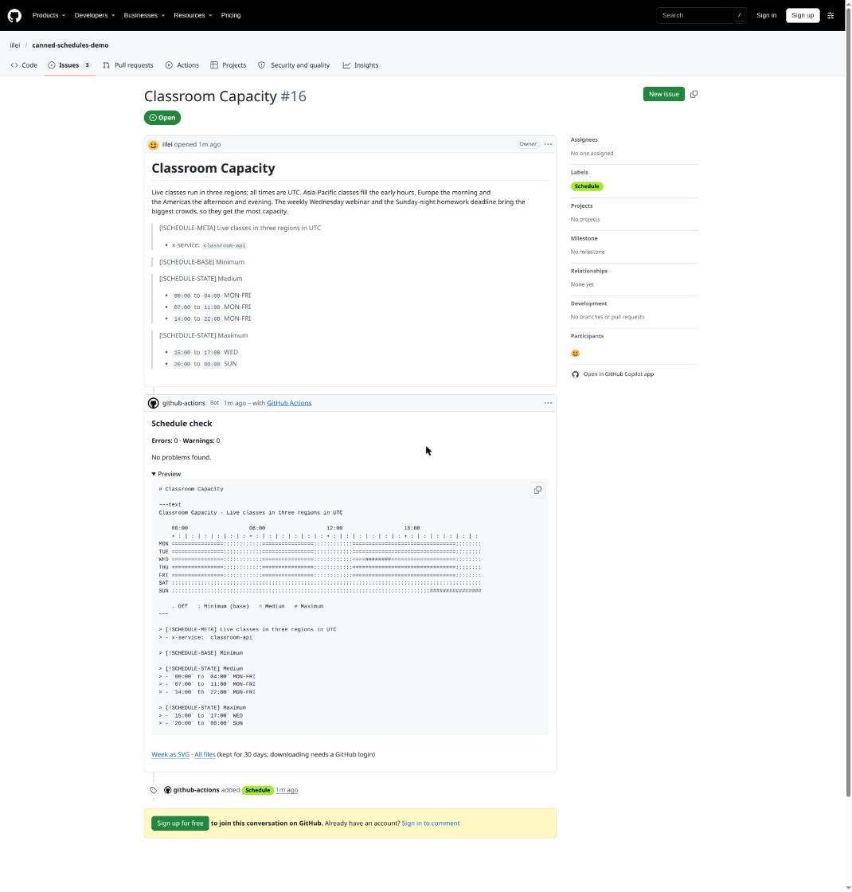
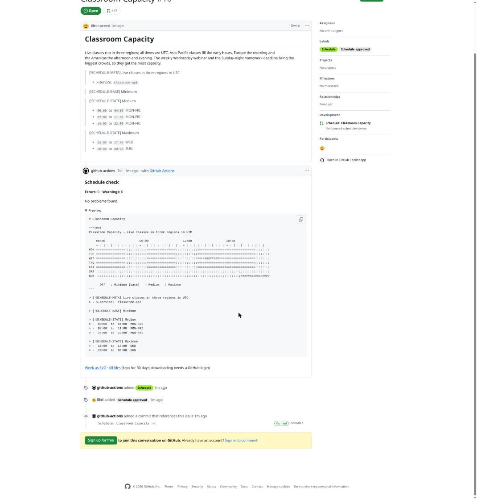
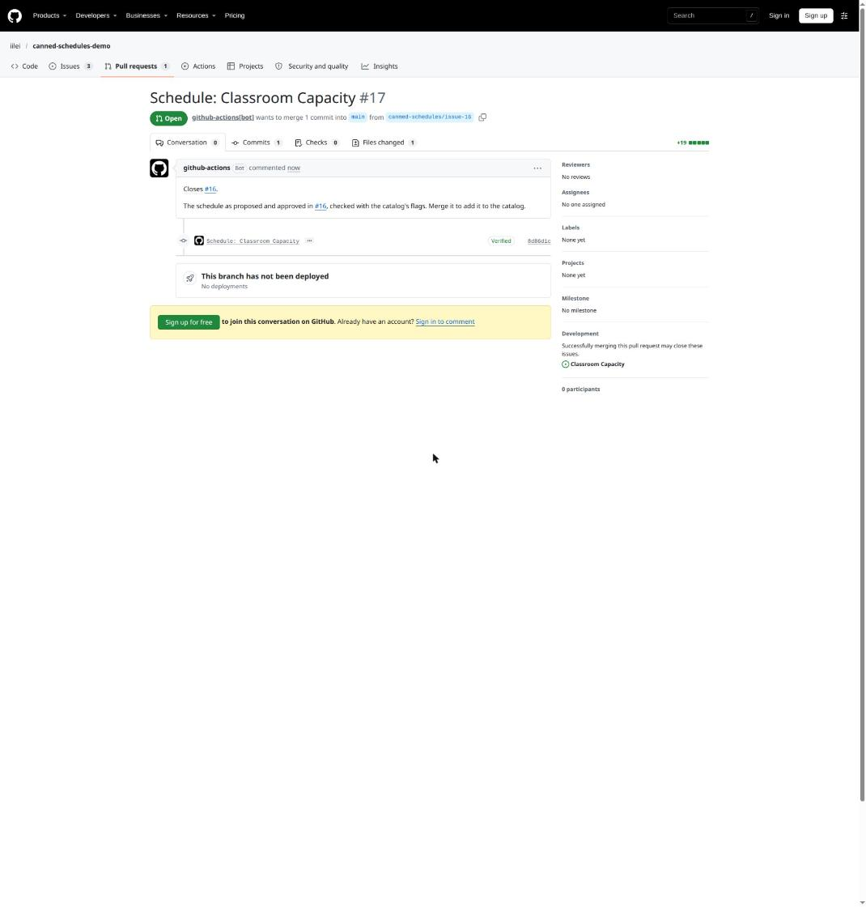
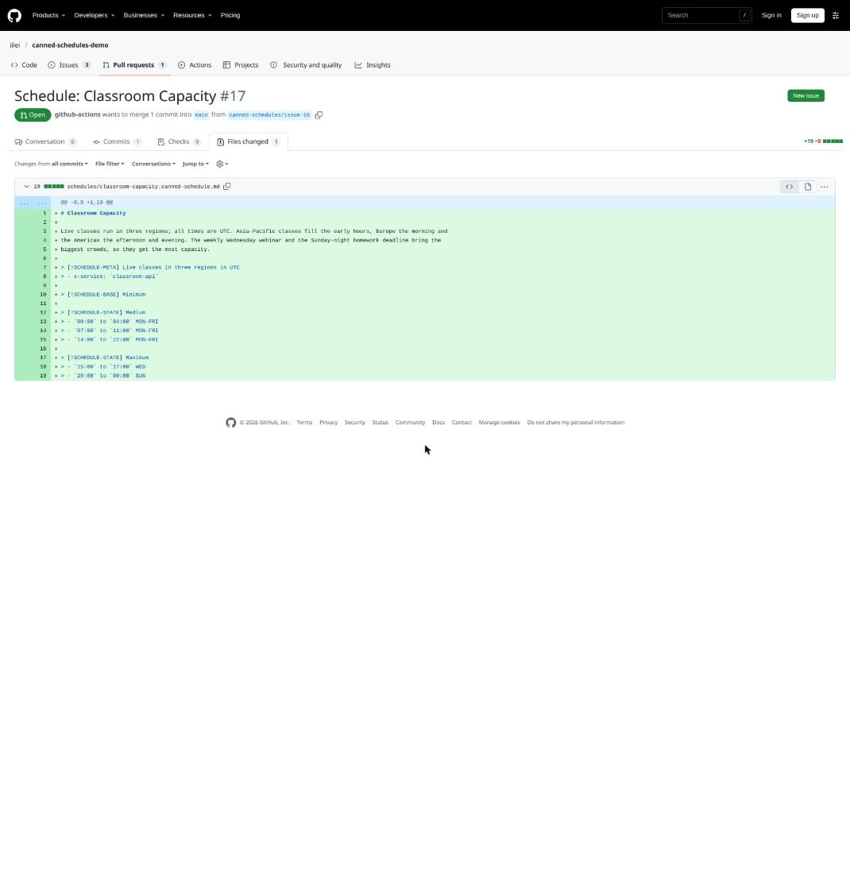
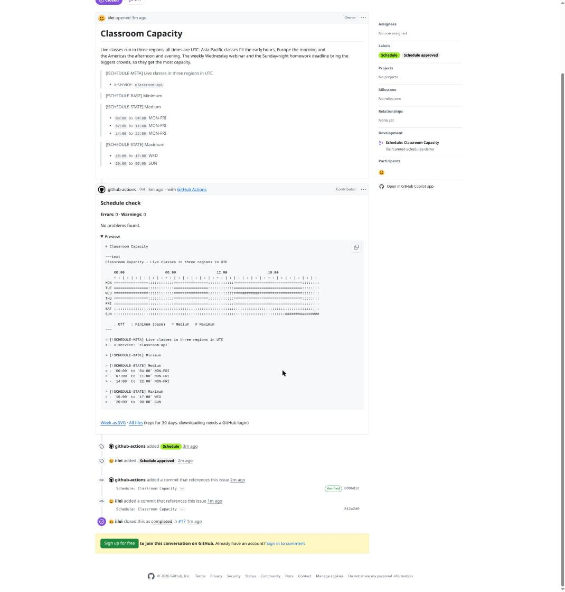
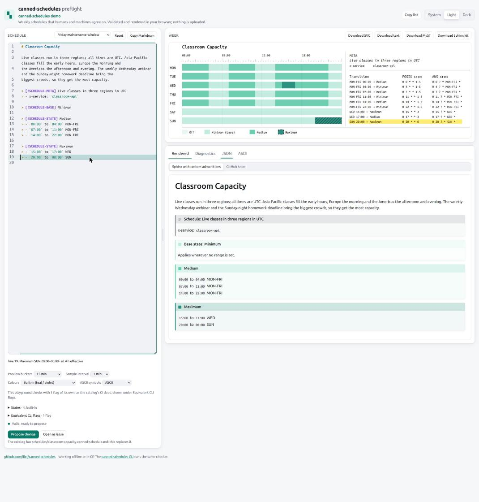

# Story: an issue becomes a capacity schedule on GitHub

An online learning platform scales its classroom API by a weekly schedule. Students learn in three regions, so the
load comes in waves at hours that look irregular from any one time zone, with extra spikes for a weekly webinar and
the Sunday-night homework deadline. This story follows one new schedule from a draft in the playground to the catalog,
through an issue, the bot's preview, a maintainer's approval and the pull request the bot opens.

Everything shown ran on the public demo repository
[`iilei/canned-schedules-demo`](https://github.com/iilei/canned-schedules-demo) with the companion's GitHub Actions
(v0.3.4) and its playground on GitHub Pages. The screenshots of GitHub were taken while logged out, so they show
GitHub's public view; the steps that need an account (opening the issue, adding the label, merging) were done as the
repository's owner.

## The setup

- **The repository:** `iilei/canned-schedules-demo`, a catalog with its schedules in `schedules/` and the flags CI
  checks with in `canned-schedules.args` (here: only GitHub's five alert types besides schedule directives). The
  states are the built-in capacity tiers: `Off`, `Minimum`, `Medium`, `Maximum`.
- **The workflows,** each a companion action:
  - `playground.yml` publishes the playground on GitHub Pages on every push to `main`.
  - `schedule-request.yml` previews an issue that holds a schedule: one comment with the report and the week.
  - `schedule-promotion.yml` turns an issue labelled `Schedule approved` into a pull request.
  - `schedule-review.yml` reviews pull requests that change a schedule.
- **The settings:** Pages with "GitHub Actions" as the source, and "Allow GitHub Actions to create and approve pull
  requests", so the workflow token may open the promotion's pull request.

## 1. The draft in the playground

The platform's SRE writes the schedule in the team's playground. All times are UTC: Asia-Pacific classes fill
`00:00` to `04:00`, Europe `07:00` to `11:00` and the Americas `14:00` to `22:00` on weekdays, which is `Medium`.
The Wednesday webinar and the Sunday-night deadline get `Maximum`; everything else stays at the base, `Minimum`.
With the cursor on line 18, the week marks the webinar with stripes and the transition table its row
("WED 15:00 → Maximum"); the status bar says it is all 2 h effective. The playground checks with the catalog's flags,
so "Valid: ready to propose" means CI will agree.

## 2. An issue, and the bot's preview

**Open as issue** opens GitHub's new-issue form with the schedule's name as the title and the text as the body. Once
the issue is submitted, the issue preview checks it with the same flags and keeps one comment on it: the report and
the week as text, with links to the SVG and all files. It sets the `Schedule` label, which means "holds a valid
schedule". An edit to the issue updates the comment in place.

## 3. A maintainer approves

A maintainer reads the issue and the week and adds the label `Schedule approved`. Setting labels takes the Triage
role, so that permission is the approval. The promotion workflow checks the text once more, commits it to the branch
`canned-schedules/issue-16` and links the pull request to the issue: it shows under "Development", and the timeline
lists the bot's commit.

## 4. The bot's pull request

The pull request is named after the schedule ("Schedule: Classroom Capacity") and says "Closes #16". A pull request
opened with the workflow token starts no other workflows, so the review doesn't run on it; the promotion already
checked the schedule with the catalog's flags.

## 5. The catalog file

One new file, named after the schedule's title: `schedules/classroom-capacity.canned-schedule.md`. Its text is the
issue's as the author wrote it, explanation included, so the catalog keeps the reason for the hours.

## 6. Merged, the issue closes

The maintainer merges. GitHub closes the issue "as completed in #17", and the push to `main` publishes the playground
again.

## 7. The playground knows the schedule

The redeployed playground lists `classroom-capacity` in its catalog. The same schedule now gets **Propose change**
instead of **Propose new schedule**, and the note names the file it replaces, so the next adjustment (a fourth region,
an exam week) starts here.

## Things this story shows

- **Two ways in, one catalog.** People who start in the playground propose a pull request directly (see
  [the shift swap on GitLab](../shift-swap/README.md)); people who start with an issue get a preview there, and an
  approval turns it into the same kind of pull request.
- **The label is the approval, and it stays honest.** If an edit breaks the schedule after the approval, the promotion
  takes the label back instead of opening a pull request with errors.
- **The bot never merges.** It checks, comments, labels and opens the pull request; whether and when to merge stays
  with the people who own the catalog.
- **The pages show the released playground** (core v0.3.4). Its header still reads "preflight" and its preset menu
  "Friday maintenance window"; both are fixed on the core's `master` and arrive with the next release.
