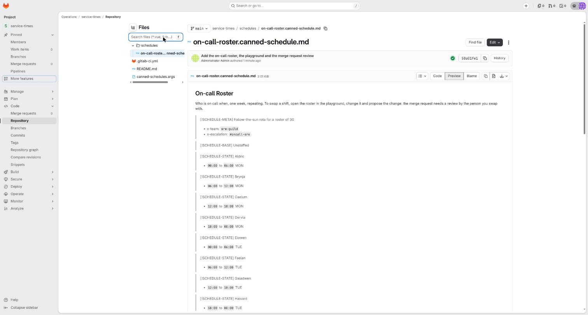
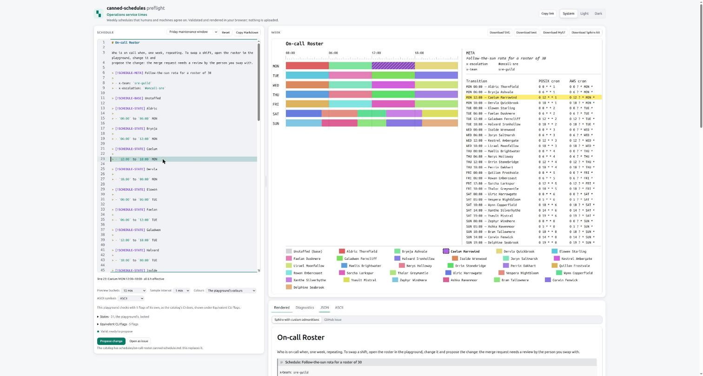
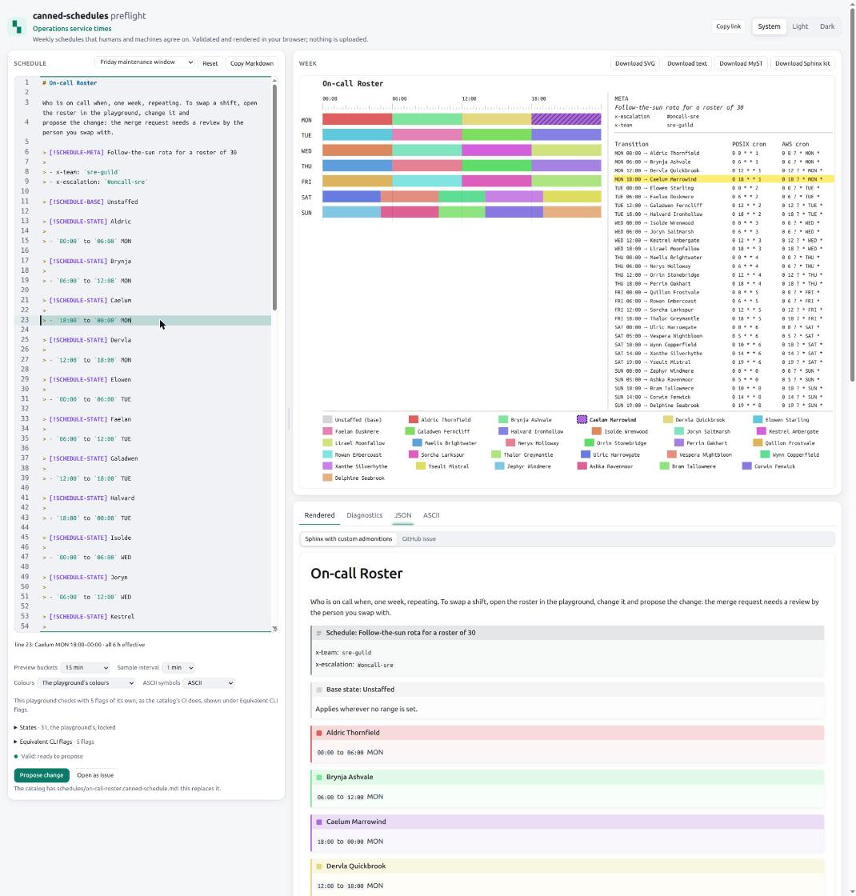
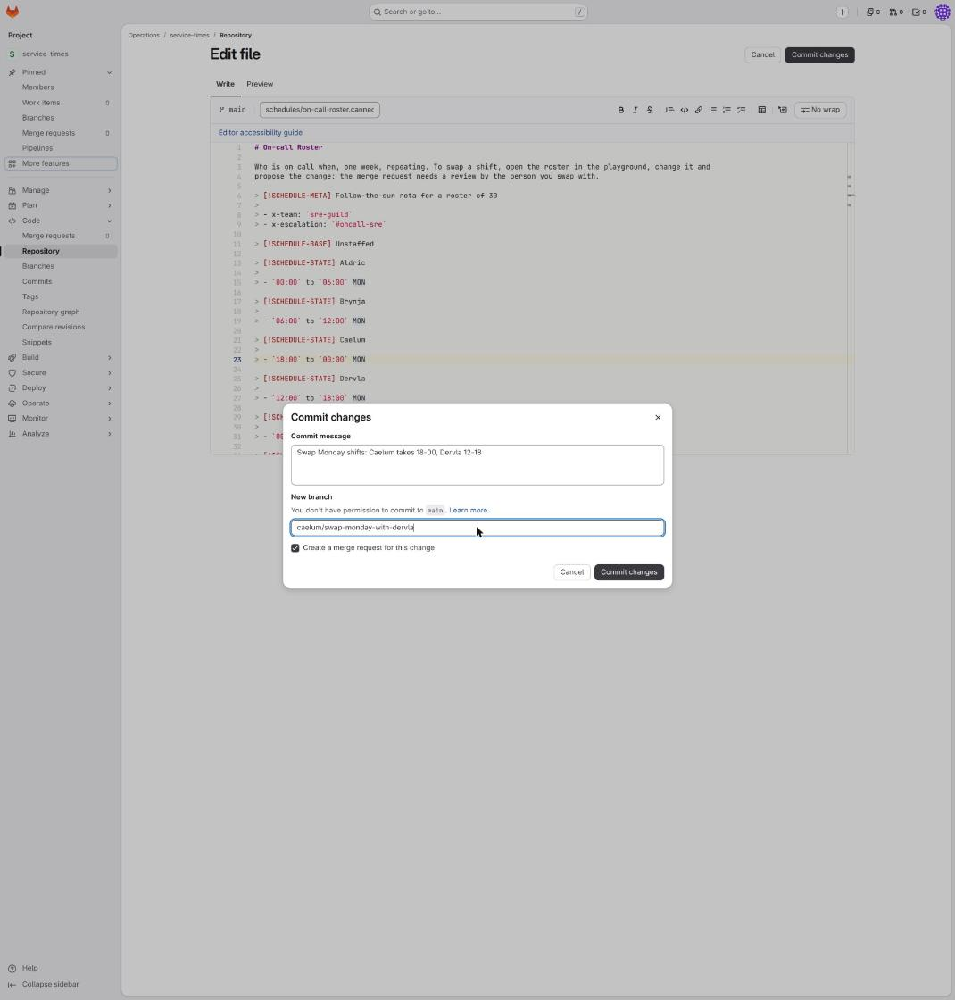
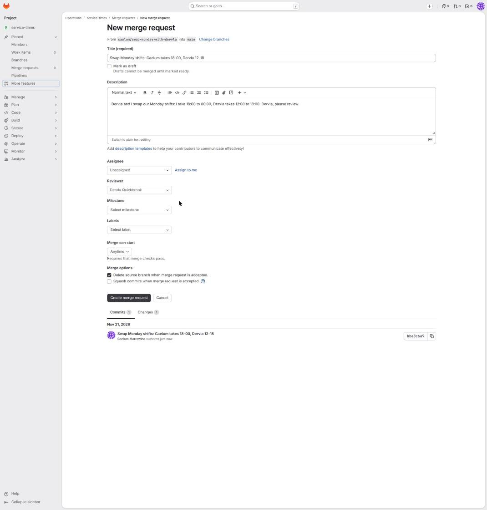
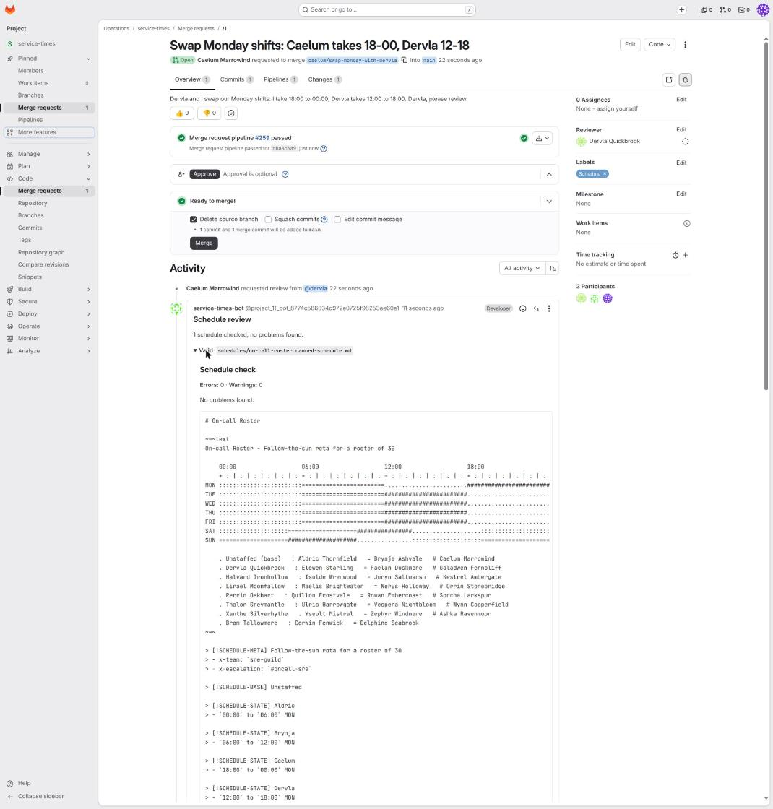
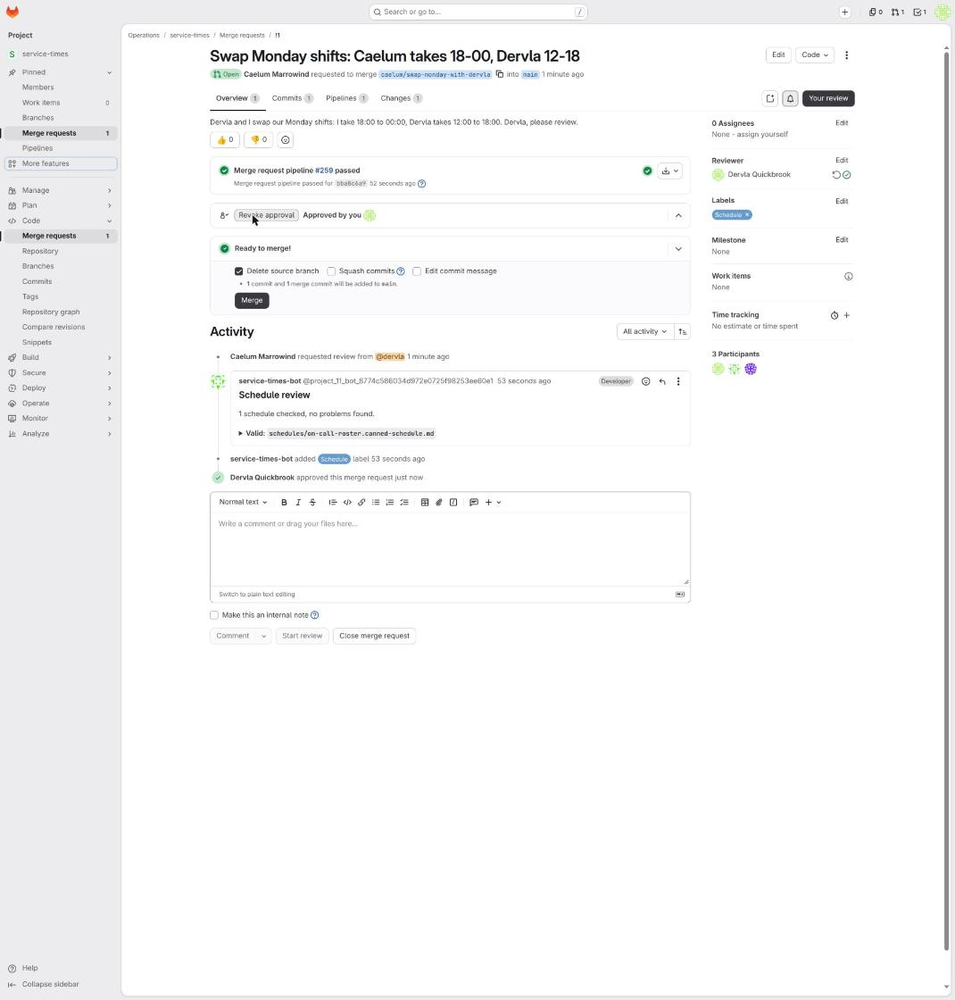
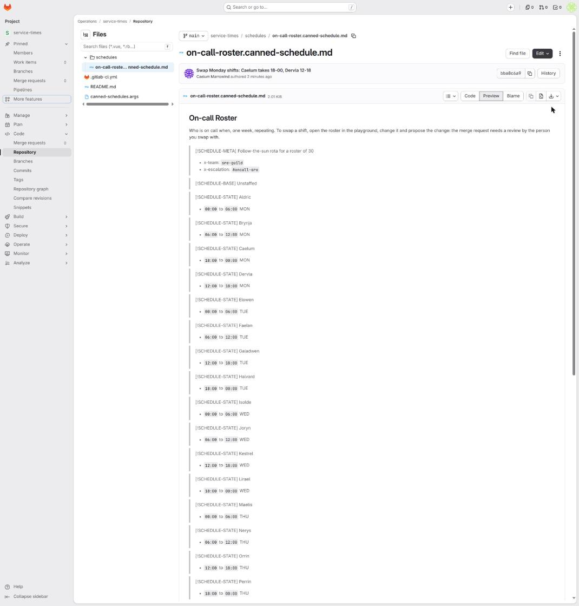

# Story: two people swap an on-call shift

A team keeps its on-call roster as a schedule in a GitLab project. Anyone on the roster can propose a change; the
person they swap with reviews it. This story walks through one swap, start to finish, with a screenshot of each step.

Everything shown ran on a local GitLab (Docker) with the released site zip on GitLab Pages, as described in
[How to host your own schedule catalog](../../self-hosted-catalog.md). The people are the 30 invented names of the
preflight page's `on-call-roster` preset.

## The setup

- **The project:** `operations/service-times`. Its default branch `main` is protected: only maintainers push, and
  developers merge through merge requests.
- **The catalog:** one schedule, `schedules/on-call-roster.canned-schedule.md`: one week, repeating, a
  `[!SCHEDULE-STATE]` block per shift, and `Unstaffed` as the base.
- **The flags:** `canned-schedules.args` sets the 30 people (plus `Unstaffed`) as the states, one colour and one letter
  each, and allows only the five GFM alert types besides schedule directives.
- **The pipeline:** `.gitlab-ci.yml` includes two components of `canned-schedules-companion`: `playground.yml`
  publishes the playground on GitLab Pages on every merge to `main`, with a `site.json` built from the args file and
  the catalog; `review.yml` checks every merge request that changes a schedule.
- **The people:** Caelum Marrowind and Dervla Quickbrook, both developers in the project. On Monday, Caelum is on
  call from 12:00 to 18:00 and Dervla from 18:00 to midnight. They agree to swap.

## 1. Caelum finds the roster

The roster is a Markdown file in the project. GitLab shows the schedule directives as plain quotes, which is all a
reader needs.

## 2. Caelum opens it in the playground

The team's playground runs on the project's GitLab Pages site. It checks with the same flags as CI (the note under
the options says so, and the States panel is locked to the roster's people). With the cursor on line 23, the week
marks Caelum's Monday shift with stripes, the transition table marks "MON 12:00 → Caelum Marrowind", and the
status bar says: line 23, Caelum, MON 12:00–18:00, all 6 h effective.

## 3. Caelum swaps the two shifts

Two lines change: Caelum's range becomes `18:00` to `00:00` MON, Dervla's `12:00` to `18:00` MON. The week
redraws as Caelum types, and the status line still says "Valid: ready to propose". Since the catalog already has
`on-call-roster`, the button reads **Propose change**, and the note under it names the file it replaces.

## 4. Caelum commits to a new branch

**Propose change** opens GitLab's editor for the roster. GitLab's edit page always loads the stored file, so the
playground copies the changed roster to the clipboard and Caelum pastes it over the old text. Because Caelum can't
push to `main`, GitLab asks for a branch and offers a merge request. The commit message and branch name are
Caelum's own: GitLab doesn't let a link set them.

## 5. Caelum asks Dervla for a review

On the new merge request form, Caelum says what the swap is and picks Dervla as the reviewer, since a swap needs
the other person's agreement.

## 6. The bot checks the roster

The merge request pipeline runs the companion's merge request review. It checks every changed
`*.canned-schedule.md` file with the flags from `main` (so a branch can't loosen them), posts one note with the
report and the week as text, and sets the `Schedule` label. The bot would also rename a merge request with a default
title after the schedule; Caelum's title stays as written.

## 7. Dervla approves

Dervla signs in, sees the review request, checks the week in the bot's note and approves.

## 8. Merged

Dervla merges. `main` now has Caelum from 18:00 to midnight and Dervla from 12:00 to 18:00 on Monday, and the
pipeline on `main` publishes the playground again, so its catalog stays current.

## Things this story shows

- **Nobody writes the file by hand.** The playground checks the change as it is typed, with the catalog's own
  flags, and only offers to propose a valid roster.
- **The forge does the rest.** A protected `main` turns every change into a merge request; the bot adds the check,
  the label and the week; whether a review is required is the project's setting.
- **Requiring Dervla's approval** takes GitLab's approval rules (Premium) or a team agreement. On GitLab CE, as
  here, approval is optional, and any developer could merge. Code owners (`CODEOWNERS`) can't name "the person you
  swap with", since that changes with every swap.
